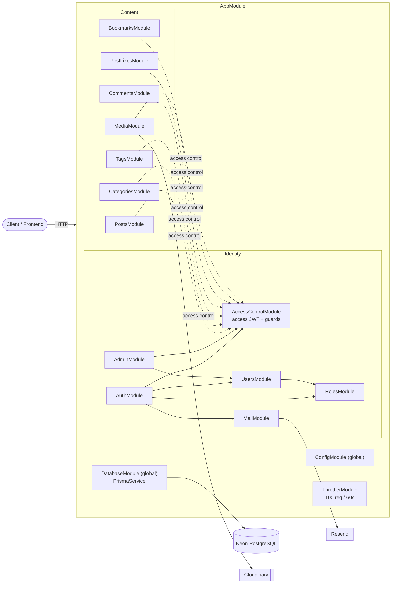
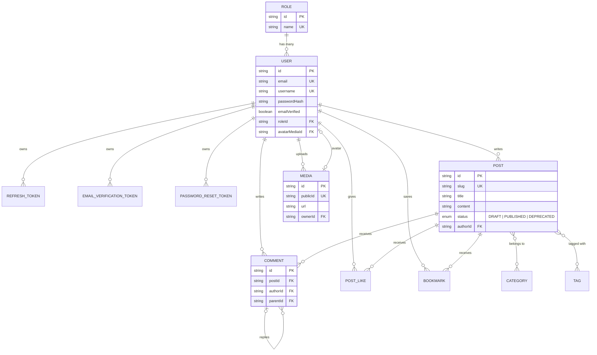
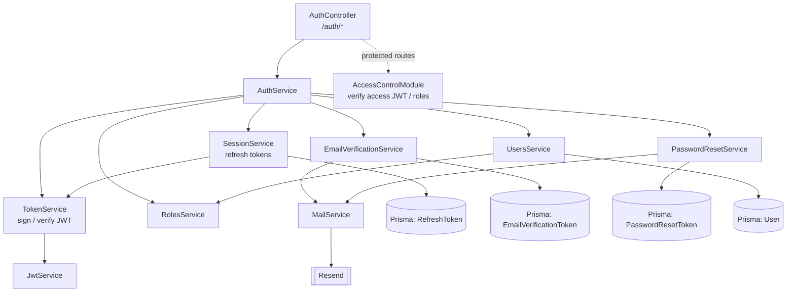
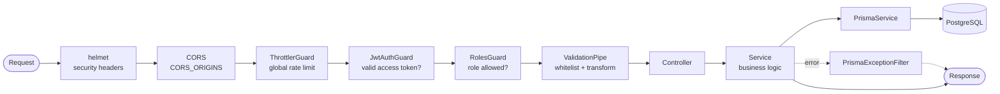

# Kia Blog Backend — Architecture

A visual map of the backend. All diagrams are [Mermaid](https://mermaid.js.org/) and render directly on GitHub.

**Stack:** NestJS · Prisma · PostgreSQL (Neon) · Cloudinary (media) · Resend (email) · Vercel (deploy)

---

## 1. Big picture: modules and external services

Every feature is its own NestJS module. Protected feature modules import the focused `AccessControlModule`, which owns access-token verification and role enforcement. Authentication workflows remain in `AuthModule`. `DatabaseModule` is `@Global()`, so `PrismaService` is injectable everywhere without being imported.



Solid arrows = workflow dependency. Dotted arrows = protected feature modules consuming the focused access-control seam.

---

## 2. Database model



Notes:

- `POST_LIKE` and `BOOKMARK` have a composite unique on `(userId, postId)`, so a user can like or bookmark a post only once.
- Deleting a `USER` cascades to their posts, comments, tokens, likes, bookmarks and media. Deleting a `COMMENT` cascades to its replies.
- Token tables store a **hash** of the token, never the raw value.

---

## 3. Inside the auth system

`AuthService` is the orchestrator. The real work is split into small single-purpose services.



---

## 4. Life of a request



`JwtAuthGuard` and `RolesGuard` only run on routes that declare them with `@UseGuards(...)`. Public routes skip straight from the throttler to validation.

---

## 5. Endpoint map by access level

| Area                         | Public                                                                          | Logged in                        | AUTHOR / ADMIN                         | ADMIN only                        |
| ---------------------------- | ------------------------------------------------------------------------------- | -------------------------------- | -------------------------------------- | --------------------------------- |
| **Auth** `/auth`             | register, login, refresh, logout, verify-email, forgot-password, reset-password | me, logout-all                   |                                        |                                   |
| **Posts** `/posts`           | list, get by slug                                                               |                                  | create, mine, mine/:id, update, delete | by-id/:id                         |
| **Categories** `/categories` | list                                                                            |                                  |                                        | create, update, delete            |
| **Tags** `/tags`             | list                                                                            |                                  |                                        | create, update, delete            |
| **Comments**                 | list on post                                                                    | create, reply, edit, delete      |                                        |                                   |
| **Likes**                    | count on post                                                                   | like, unlike                     |                                        |                                   |
| **Bookmarks**                |                                                                                 | bookmark, unbookmark, list mine  |                                        |                                   |
| **Media** `/media`           |                                                                                 | upload image, delete, set avatar |                                        |                                   |
| **Admin** `/admin`           |                                                                                 |                                  |                                        | list users, get user, change role |
| **App**                      | `/`, `/health`                                                                  |                                  |                                        |                                   |

Roles: `USER`, `AUTHOR`, `ADMIN`.

---

## 6. Folder layout

```mermaid
flowchart LR
backend/
├── prisma/                 schema + migrations
├── src/
│   ├── main.ts             bootstrap: helmet, Swagger, CORS, ValidationPipe, filter
│   ├── app.module.ts       root module, global throttler guard
│   ├── database/           PrismaService (global)
│   ├── common/filters/     PrismaExceptionFilter
│   ├── access-control/     access JWT config, guards, decorators, request identity types
│   ├── auth/               authentication controller and token/session/email workflows
│   ├── users/ roles/ admin/ mail/
│   ├── posts/ categories/ tags/ comments/ post-likes/ bookmarks/ media/
│   └── generated/prisma/   auto-generated client (do not edit)
└── test/                   e2e tests (Vitest + Supertest)
```

Each feature folder follows the same pattern: `*.module.ts` → `*.controller.ts` → `*.service.ts`, plus `dto/` for input validation and `*.spec.ts` for unit tests.

## Posts internals

`PostsService` remains the stable external interface of the Posts module. Its
internal seam separates `PostCommands` (creation, slug allocation, publication
transitions, relation replacement, and deletion) from `PostQueries` (visibility,
filtering, pagination, and safe read projections). Neither is exported from
`PostsModule`. They use the existing Prisma adapter, without adding repository
interfaces or a command bus.

This depth gives callers leverage without changing routes, arguments, responses,
or access rules. Publication changes have locality in commands; read-model changes
have locality in queries. The shared ownership policy keeps owner/admin decisions
consistent across private reads and mutations.

Behavior tests cross the existing Posts interface and replace only persistence.
The isolated HTTP contract suite imports the real Posts module and exercises its
wiring, guards, and validation without connecting to PostgreSQL or Cloudinary.
This is an organization refactor, not a concurrency fix: slug collision checking
still has a check/insert race, and pagination still uses separate read/count queries.

## Published Post visibility

`PublishedPostsModule` owns the shared visibility seam. Its `PublishedPosts`
interface provides a fresh `where()` predicate for reads and relational filters,
and `requireById()` for existence/eligibility checks with a consistent 404. The
existing Prisma adapter stays behind this module; no new repository abstraction
is introduced. The module imports only `DatabaseModule`, not authentication or
the Posts workflow module.

Posts, Comments, Bookmarks, and Post Likes explicitly import this module. Public
feed/detail reads, comment creation/listing/replies, like creation/counts, and
bookmark creation/listing use the same rule. This gives visibility changes
locality and gives consumers leverage without coupling them to Posts workflows.
Replies retain one relational lookup and the existing parent-not-found error.

Intentional behavior fix: a saved Bookmark no longer exposes Post content after
that Post becomes DRAFT or DEPRECATED. The Bookmark itself is retained, so it can
be removed or become visible again on republication. Private owner/admin Post
reads and removal of existing interactions keep their existing behavior.

The shared interface adds depth by concentrating eligibility, query construction,
minimal existence lookup, and errors in one place. Tests import the real feature
modules and replace persistence, exercising published/unpublished/missing Posts
and ensuring rejected operations never reach interaction reads/writes. This does
not make eligibility-check/write sequences atomic against concurrent unpublishing.
